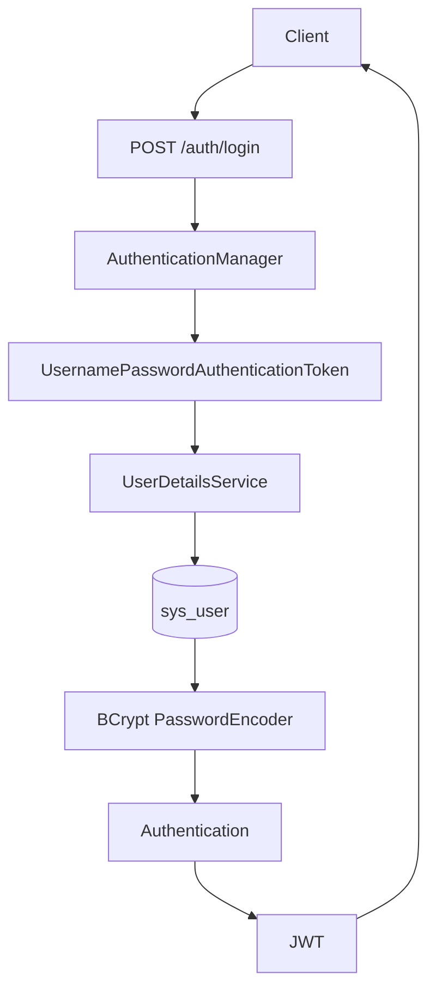

# CampusTrain

CampusTrain 是一个基于 Spring Boot、Spring Cloud Alibaba 和 MyBatis-Plus 的校园培训业务项目。

## training-service 内容结构

```text
Training
 └── Course
      └── Chapter
           └── Lesson
```

## 阶段 4：课程、章节、课时内容模型

training-service 在阶段 4 新增课程、章节、课时与培训课程目录接口。

### 课程管理

| 方法 | 路径 | 说明 |
| --- | --- | --- |
| POST | `/courses` | 创建课程 |
| PUT | `/courses` | 修改课程 |
| GET | `/courses/{id}` | 查询课程详情 |
| GET | `/courses/training/{trainingId}` | 查询培训下课程 |
| DELETE | `/courses/{id}` | 删除课程 |

### 章节管理

| 方法 | 路径 | 说明 |
| --- | --- | --- |
| POST | `/chapters` | 创建章节 |
| PUT | `/chapters` | 修改章节 |
| GET | `/chapters/course/{courseId}` | 查询课程下章节 |
| PUT | `/chapters/sort` | 章节排序 |
| DELETE | `/chapters/{id}` | 删除章节 |

### 课时管理

| 方法 | 路径 | 说明 |
| --- | --- | --- |
| POST | `/lessons` | 创建课时 |
| PUT | `/lessons` | 修改课时 |
| GET | `/lessons/chapter/{chapterId}` | 查询章节下课时 |
| PUT | `/lessons/sort` | 课时排序 |
| DELETE | `/lessons/{id}` | 删除课时 |

### 培训课程目录

| 方法 | 路径 | 说明 |
| --- | --- | --- |
| GET | `/trainings/{trainingId}/catalog` | 查询培训课程目录 |

目录接口按 Course、Chapter、Lesson 三次批量查询组装树形结构，避免在循环中查询数据库。

## 接口文档

training-service 启动后可访问：

- Knife4j：`http://localhost:8082/doc.html`
- OpenAPI JSON：`http://localhost:8082/v3/api-docs`

## 阶段 5：User Service、Auth Service 与 JWT

阶段 5 建立基础身份体系，包含用户资料、角色、BCrypt 密码哈希、Spring Security 登录认证、JWT 签发与解析。

### 服务职责

- `user-service`：维护 `sys_user` 用户资料，负责用户 CRUD。创建用户时接收明文密码，但只保存 BCrypt 哈希；查询、分页、详情接口不会返回 `passwordHash`。
- `auth-service`：负责登录认证、JWT 签发和阶段 5 自测用的 Token 解析。由于阶段 6 才引入 OpenFeign，本阶段 `auth-service` 临时直连 `campus_user` 数据库读取 `sys_user`，用于完成身份认证闭环。后续跨服务调用再按服务边界演进。
- `campus-gateway`：阶段 5 不做 JWT Filter，统一网关鉴权留到阶段 7。

### 登录流程



### 用户接口

| 服务 | 方法 | 路径 | 说明 |
| --- | --- | --- | --- |
| user-service | POST | `/users` | 创建用户，密码写入 BCrypt 哈希 |
| user-service | GET | `/users/{id}` | 查询用户详情 |
| user-service | GET | `/users/page` | 分页查询用户 |
| user-service | PUT | `/users` | 修改 nickname、role、status |
| user-service | DELETE | `/users/{id}` | 删除用户 |

### 认证接口

| 服务 | 方法 | 路径 | 说明 |
| --- | --- | --- | --- |
| auth-service | POST | `/auth/login` | 登录并签发 Access Token |
| auth-service | GET | `/auth/token-info` | 解析 Bearer Token，返回 userId、username、role |

### 开发测试账号

阶段 5 初始化 SQL 会写入以下开发账号，密码均为 `123456`，数据库中只保存 BCrypt 哈希。

| username | role |
| --- | --- |
| `student01` | `STUDENT` |
| `teacher01` | `TEACHER` |
| `admin01` | `ADMIN` |

这些账号仅用于开发环境。

### 密码与 Token 策略

- 密码不能明文存储，因为数据库泄露时明文密码会直接暴露用户凭据；当前使用 Spring Security `BCryptPasswordEncoder` 生成 `password_hash`。
- JWT 使用 HMAC SHA 签名，Secret 通过 `jwt.secret` 配置，默认值仅用于开发；生产环境必须使用 `JWT_SECRET` 环境变量。
- JWT Claims 包含：`sub`/username、`userId`、`role`、`iat`、`exp`。
- Access Token 默认有效期为 2 小时，即 `7200000 ms`，接口返回的 `expiresIn` 单位是秒。
- 阶段 5 不实现 Refresh Token。Access Token 到期后重新登录。
- 登录请求中会设置当前请求的 `SecurityContext`，但 JWT 架构下后续请求不能依赖内存 Context 长期保存身份，后续请求必须通过 Token 重建身份。

## 阶段 6：OpenFeign 跨服务报名链路

阶段 6 新增 `enrollment-service`，报名时只通过 OpenFeign 获取用户与培训资料，不直接连接 `campus_user` 或 `campus_training`。

```text
Client
  |
  v
enrollment-service
  |-- Feign (user-service -> Nacos -> LoadBalancer -> HTTP GET /users/{id})
  |     |
  |     v
  |  campus_user
  |
  `-- Feign (training-service -> Nacos -> LoadBalancer -> HTTP GET /trainings/{id})
        |
        v
     campus_training

enrollment-service -> campus_enrollment
```

Feign Client 使用服务名发现实例，不配置服务 IP 或 URL；Nacos 负责实例发现，Spring Cloud LoadBalancer 从健康实例中选择目标，OpenFeign 最终发起 HTTP 调用。远程 DTO 和远程响应包装均由 `enrollment-service` 独立维护，不复用其他服务的 Java 模型。

### 报名接口

| 方法 | 路径 | 说明 |
| --- | --- | --- |
| POST | `/enrollments` | 创建培训报名，成功返回报名 ID |

阶段 6 为验证 Feign 链路，`userId` 暂由 `EnrollmentCreateDTO` 请求体传入；阶段 7 将改为从 Gateway 透传的身份上下文获取。

报名会校验用户存在、启用状态和 `STUDENT` 角色，以及培训存在、报名状态、报名时间窗口和基础容量。`enrollment` 表的 `uk_user_training (user_id, training_id)` 唯一索引与服务层预检查共同防止重复报名。

当前容量校验是普通读取校验，不能解决高并发超卖；培训已报名人数的一致性和高并发更新将在后续报名并发阶段完成。本阶段不更新 `training.enrolled_count`，也不引入跨库操作或分布式事务。

依赖服务不可用时，`enrollment-service` 记录带服务上下文的 Feign 错误日志，并向客户端返回明确的“用户服务暂时不可用”或“培训服务暂时不可用”。阶段 6 不提供 Sentinel 或 Feign fallback；这些能力安排在阶段 10。

enrollment-service 启动后可访问：

- Knife4j：`http://localhost:8083/doc.html`
- OpenAPI JSON：`http://localhost:8083/v3/api-docs`
