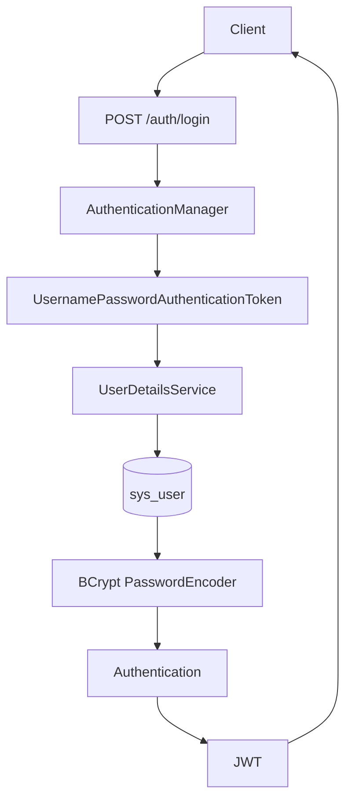

# CampusTrain

CampusTrain 是一个基于 Spring Boot、Spring Cloud Alibaba 和 MyBatis-Plus 的校园培训业务项目。

## training-service 内容结构

```text
Training
 └── Course
      └── Chapter
           └── Lesson
```

## 阶段 4：课程、章节、课时内容模型

training-service 在阶段 4 新增课程、章节、课时与培训课程目录接口。

### 课程管理

| 方法 | 路径 | 说明 |
| --- | --- | --- |
| POST | `/courses` | 创建课程 |
| PUT | `/courses` | 修改课程 |
| GET | `/courses/{id}` | 查询课程详情 |
| GET | `/courses/training/{trainingId}` | 查询培训下课程 |
| DELETE | `/courses/{id}` | 删除课程 |

### 章节管理

| 方法 | 路径 | 说明 |
| --- | --- | --- |
| POST | `/chapters` | 创建章节 |
| PUT | `/chapters` | 修改章节 |
| GET | `/chapters/course/{courseId}` | 查询课程下章节 |
| PUT | `/chapters/sort` | 章节排序 |
| DELETE | `/chapters/{id}` | 删除章节 |

### 课时管理

| 方法 | 路径 | 说明 |
| --- | --- | --- |
| POST | `/lessons` | 创建课时 |
| PUT | `/lessons` | 修改课时 |
| GET | `/lessons/chapter/{chapterId}` | 查询章节下课时 |
| PUT | `/lessons/sort` | 课时排序 |
| DELETE | `/lessons/{id}` | 删除课时 |

### 培训课程目录

| 方法 | 路径 | 说明 |
| --- | --- | --- |
| GET | `/trainings/{trainingId}/catalog` | 查询培训课程目录 |

目录接口按 Course、Chapter、Lesson 三次批量查询组装树形结构，避免在循环中查询数据库。

## 接口文档

training-service 启动后可访问：

- Knife4j：`http://localhost:8082/doc.html`
- OpenAPI JSON：`http://localhost:8082/v3/api-docs`

## 阶段 5：User Service、Auth Service 与 JWT

阶段 5 建立基础身份体系，包含用户资料、角色、BCrypt 密码哈希、Spring Security 登录认证、JWT 签发与解析。

### 服务职责

- `user-service`：维护 `sys_user` 用户资料，负责用户 CRUD。创建用户时接收明文密码，但只保存 BCrypt 哈希；查询、分页、详情接口不会返回 `passwordHash`。
- `auth-service`：负责登录认证、JWT 签发和阶段 5 自测用的 Token 解析。由于阶段 6 才引入 OpenFeign，本阶段 `auth-service` 临时直连 `campus_user` 数据库读取 `sys_user`，用于完成身份认证闭环。后续跨服务调用再按服务边界演进。
- `campus-gateway`：阶段 5 不做 JWT Filter，统一网关鉴权留到阶段 7。

### 登录流程



### 用户接口

| 服务 | 方法 | 路径 | 说明 |
| --- | --- | --- | --- |
| user-service | POST | `/users` | 创建用户，密码写入 BCrypt 哈希 |
| user-service | GET | `/users/{id}` | 查询用户详情 |
| user-service | GET | `/users/page` | 分页查询用户 |
| user-service | PUT | `/users` | 修改 nickname、role、status |
| user-service | DELETE | `/users/{id}` | 删除用户 |

### 认证接口

| 服务 | 方法 | 路径 | 说明 |
| --- | --- | --- | --- |
| auth-service | POST | `/auth/login` | 登录并签发 Access Token |
| auth-service | GET | `/auth/token-info` | 解析 Bearer Token，返回 userId、username、role |

### 开发测试账号

阶段 5 初始化 SQL 会写入以下开发账号，密码均为 `123456`，数据库中只保存 BCrypt 哈希。

| username | role |
| --- | --- |
| `student01` | `STUDENT` |
| `teacher01` | `TEACHER` |
| `admin01` | `ADMIN` |

这些账号仅用于开发环境。

三个测试账号的明文密码均为 `123456`；`stage05_user.sql` 写入的是可供 Spring Security 校验的真实 BCrypt 哈希，而非明文密码。

### 密码与 Token 策略

- 密码不能明文存储，因为数据库泄露时明文密码会直接暴露用户凭据；当前使用 Spring Security `BCryptPasswordEncoder` 生成 `password_hash`。
- JWT 使用 HMAC SHA 签名，Secret 通过 `jwt.secret` 配置，默认值仅用于开发；生产环境必须使用 `JWT_SECRET` 环境变量。
- JWT Claims 包含：`sub`/username、`userId`、`role`、`iat`、`exp`。
- Access Token 默认有效期为 2 小时，即 `7200000 ms`，接口返回的 `expiresIn` 单位是秒。
- 阶段 5 不实现 Refresh Token。Access Token 到期后重新登录。
- 登录请求中会设置当前请求的 `SecurityContext`，但 JWT 架构下后续请求不能依赖内存 Context 长期保存身份，后续请求必须通过 Token 重建身份。

## 阶段 6：OpenFeign 跨服务报名链路

阶段 6 新增 `enrollment-service`，报名时只通过 OpenFeign 获取用户与培训资料，不直接连接 `campus_user` 或 `campus_training`。

```text
Client
  |
  v
enrollment-service
  |-- Feign (user-service -> Nacos -> LoadBalancer -> HTTP GET /users/{id})
  |     |
  |     v
  |  campus_user
  |
  `-- Feign (training-service -> Nacos -> LoadBalancer -> HTTP GET /trainings/{id})
        |
        v
     campus_training

enrollment-service -> campus_enrollment
```

Feign Client 使用服务名发现实例，不配置服务 IP 或 URL；Nacos 负责实例发现，Spring Cloud LoadBalancer 从健康实例中选择目标，OpenFeign 最终发起 HTTP 调用。远程 DTO 和远程响应包装均由 `enrollment-service` 独立维护，不复用其他服务的 Java 模型。

### 报名接口

| 方法 | 路径 | 说明 |
| --- | --- | --- |
| POST | `/enrollments` | 创建培训报名，成功返回报名 ID |

阶段 6 为验证 Feign 链路，`userId` 曾暂由 `EnrollmentCreateDTO` 请求体传入；阶段 7 后报名请求只传 `trainingId`，用户身份由 Gateway 透传的上下文提供。

报名会校验用户存在、启用状态和 `STUDENT` 角色，以及培训存在、报名状态、报名时间窗口和基础容量。`enrollment` 表的 `uk_user_training (user_id, training_id)` 唯一索引与服务层预检查共同防止重复报名。

当前容量校验是普通读取校验，不能解决高并发超卖；培训已报名人数的一致性和高并发更新将在后续报名并发阶段完成。本阶段不更新 `training.enrolled_count`，也不引入跨库操作或分布式事务。

依赖服务不可用时，`enrollment-service` 记录带服务上下文的 Feign 错误日志，并向客户端返回明确的“用户服务暂时不可用”或“培训服务暂时不可用”。阶段 6 不提供 Sentinel 或 Feign fallback；这些能力安排在阶段 10。

enrollment-service 启动后可访问：

- Knife4j：`http://localhost:8083/doc.html`
- OpenAPI JSON：`http://localhost:8083/v3/api-docs`

### 阶段 6 数据库初始化

SQL 文件放在项目中不会自动执行。当前需要手动按以下顺序执行：

1. `user-service/sql/stage05_user.sql`
2. `training-service/sql/stage06-feign-test-data.sql`
3. `enrollment-service/sql/stage06_enrollment.sql`

`stage06-feign-test-data.sql` 使用固定培训 ID `90001` 至 `90005`，通过 `INSERT ... ON DUPLICATE KEY UPDATE` 可重复执行，不会删除 Stage 4 数据。`stage06-test-clean.sql` 仅清理这五个培训对应的报名测试记录，不会清空报名表。

当前不使用 Flyway 或 Liquibase，也不配置 `spring.sql.init.mode=always`。

## 阶段 7：Spring Cloud Gateway 统一入口

Gateway 是系统统一入口，通过 Nacos 与 Spring Cloud LoadBalancer 将请求转发到 `auth-service`、`user-service`、`training-service` 与 `enrollment-service`。

```text
Client
  -> Gateway
  -> JWT 校验
  -> X-User-Id / X-User-Role / X-Username / X-Trace-Id
  -> enrollment-service
  -> UserContext
  -> Feign user-service / training-service
  -> campus_enrollment
```

`POST /auth/login` 与 `GET /actuator/health` 不需要 Token。其他 Gateway 业务请求必须携带 `Authorization: Bearer <token>`；Gateway 使用与 auth-service 相同的 `JWT_SECRET` 和 JJWT 配置校验签名及有效期。

客户端传入的 `X-User-Id`、`X-User-Role`、`X-Username` 与 `X-Trace-Id` 不可信。Gateway 会先移除身份 Header，再以 JWT Claims 生成真实身份 Header；TraceId 由 Gateway 为每个请求生成新的 UUID，覆盖客户端值。enrollment-service 的 Servlet Filter 将可信 Header 写入 ThreadLocal `UserContext`，并在 `finally` 中清理，避免线程复用污染。

阶段 7 后 `POST /enrollments` 的请求体只包含 `trainingId`，不再接收 `userId`。报名服务仍会通过 Feign 查询 user-service 做最终用户状态和角色校验。

## 阶段 8：Nacos 配置中心

Nacos Discovery 提供服务注册与发现，Nacos Config 提供配置加载和变更通知；两者使用同一 Nacos 地址，但命名空间可分别设置。五个服务均使用 `spring-cloud-starter-alibaba-nacos-config`，通过本地 `application.yml` 的 `spring.config.import` 加载远程配置，不使用 `bootstrap.yml`、`shared-configs` 或 `extension-configs`。

启动流程：本地配置先提供应用名、端口、Nacos 地址、Config namespace 和导入列表；随后从 Nacos 导入共享配置和该服务的独立配置，并注册 Discovery。当前 Config 使用 `campustrain-dev` namespace，Discovery 仍使用原有 `public` namespace 和 `DEFAULT_GROUP`，不会切换已有注册环境。

### 配置清单

以下六个文件均是可直接复制到 Nacos 的完整 YAML；类型为 `yaml`，namespace ID 为 `campustrain-dev`，group 均为 `CAMPUS_TRAIN`：

| 配置 | namespace | group | Data ID | 用途 |
| --- | --- | --- | --- | --- |
| [公共配置](config/nacos/campustrain-common-dev.yaml) | `campustrain-dev` | `CAMPUS_TRAIN` | `campustrain-common-dev.yaml` | Knife4j 开关、健康详情展示策略 |
| [Gateway](config/nacos/campus-gateway-dev.yaml) | `campustrain-dev` | `CAMPUS_TRAIN` | `campus-gateway-dev.yaml` | 应用信息 |
| [User](config/nacos/user-service-dev.yaml) | `campustrain-dev` | `CAMPUS_TRAIN` | `user-service-dev.yaml` | OpenAPI 扫描范围 |
| [Training](config/nacos/training-service-dev.yaml) | `campustrain-dev` | `CAMPUS_TRAIN` | `training-service-dev.yaml` | OpenAPI 扫描范围、创建开关 |
| [Enrollment](config/nacos/enrollment-service-dev.yaml) | `campustrain-dev` | `CAMPUS_TRAIN` | `enrollment-service-dev.yaml` | OpenAPI 扫描范围 |
| [Auth](config/nacos/auth-service-dev.yaml) | `campustrain-dev` | `CAMPUS_TRAIN` | `auth-service-dev.yaml` | OpenAPI 扫描范围 |

Namespace 用于环境隔离，group 用于项目/配置分组，Data ID 标识具体配置文件。dev 默认使用上表；test/prod 分别规划独立 namespace，由部署环境设置实际的 `NACOS_CONFIG_NAMESPACE`，并设置 `CAMPUS_ENV=test` 或 `prod`，相应 Data ID 使用 `*-test.yaml` 或 `*-prod.yaml`。test/prod 配置需要在各自 namespace 单独创建，代码没有硬编码生产 namespace ID。切换 Config namespace 不会自动切换 Discovery namespace；生产部署应另行配置 Discovery 的环境隔离。

首次部署时，先在 Nacos 创建目标 namespace，再按上表创建六个配置，内容取自对应文件。本项目使用非 optional 的 Nacos Config 导入；不要将示例文件放在项目内就误认为已发布。若 Nacos 启用了认证，还需在启动环境中配置相应 Nacos 认证参数。

### 配置来源与敏感信息

本地保留应用名、端口、Nacos 连接与导入信息、Gateway 路由、数据库地址和数据库选择，以及 JWT 的环境变量占位符。数据库仍分别使用 `campus_user`、`campus_training`、`campus_enrollment`；用户名通过 `MYSQL_USERNAME` 提供，密码通过 `MYSQL_PASSWORD` 提供，未设置时默认使用 `root` / `123`。该默认值仅供当前本地开发，生产环境必须通过环境变量覆盖，不能将真实生产密码、生产 JWT Secret 或其他凭据提交到 Git 或发布到示例配置。`.env.example` 仅是开发示例，Spring Boot 不会自动加载它。

Gateway 和 auth-service 使用同一 `JWT_SECRET` 环境变量，未设置时使用仅供开发的相同默认值；生产部署必须给两个服务提供一致且足够强的真实 Secret。不要把空字符串作为生产 Secret。

对同名属性，当前 Config Data 导入顺序为本地 `application.yml`、Nacos 公共配置、Nacos 服务独立配置，后者覆盖前者；操作系统环境变量、Java 系统属性和命令行参数的优先级高于这些 Config Data。`MYSQL_PASSWORD`、`JWT_SECRET` 是本地占位符引用的环境变量；直接提供对应 Spring 属性的高优先级来源也会覆盖配置。部署环境的属性覆盖可能使 Nacos 动态变更看起来不生效。详细规则参见 [Spring Boot 外部配置](https://docs.spring.io/spring-boot/reference/features/external-config.html) 与 [Spring Cloud Alibaba Nacos Config](https://github.com/alibaba/spring-cloud-alibaba/blob/2025.1.x/spring-cloud-alibaba-examples/nacos-example/readme-zh.md)。

### 动态开关验收

`TrainingFeatureProperties` 使用 `@ConfigurationProperties` 和 `@RefreshScope`，`TrainingServiceImpl` 在创建培训前检查 `campustrain.training.allow-create`；它不影响其他 CRUD。导入地址包含 `refreshEnabled=true`，Nacos 配置变更会触发刷新，无需重新打包或重启。

1. 启动 Nacos，创建并发布上述六份 dev 配置；本地可使用默认数据库凭据，按需设置环境变量和 JWT Secret，然后启动五个服务。
2. 确认 `training-service-dev.yaml` 中 `allow-create: true`，向 training-service 的 `POST /trainings` 发送合法请求，确认创建成功。
3. 在 Nacos 的 `campustrain-dev / CAMPUS_TRAIN / training-service-dev.yaml` 将其改为 `false` 并发布；等待配置刷新后再次请求，确认返回 `当前已关闭培训创建功能`。
4. 改回 `true` 并发布；不重启服务再次请求，确认恢复创建。注意不要用更高优先级的环境变量或命令行参数固定该属性。

## 阶段 9：Spring Cloud LoadBalancer 与多实例

`training-service` 是一个 Service，不同端口启动的进程是该 Service 下的不同 Instance。Nacos 负责注册、发现并提供健康实例列表；Spring Cloud LoadBalancer 从列表中选择实例，不是 Nacos 将每个 HTTP 请求轮询到实例。Gateway 通过 `lb://training-service`，Enrollment 的 `TrainingClient` 通过 `@FeignClient(name = "training-service")` 使用 LoadBalancer；未引入自定义算法或固定实例地址。

```text
Client -> Gateway -> lb://training-service -> Nacos 实例列表 -> LoadBalancer -> training instance
Client -> Gateway -> enrollment-service -> TrainingClient -> Nacos 实例列表 -> LoadBalancer -> training instance
```

`GET /trainings/instance` 返回统一 `Result`，其中 `data` 包含应用名、实际监听端口和 `应用名:端口` 实例标识。通过 Gateway 访问仍需 JWT；该标识用于本机多端口实验，并非跨主机全局唯一标识。培训详情日志同时包含 `traceId`、`trainingId` 和实例标识。

### 启动与发现

1. 启动 Nacos，并按阶段 8 发布公共配置和 `training-service-dev.yaml`；启动 user、auth、enrollment、Gateway。三个 training 实例读取同一组 Nacos Config，使用同一个 `campus_training` 数据库。
2. 执行 `mvn clean package -DskipTests`，在三个终端分别运行同一个可执行 JAR：

```powershell
java -jar training-service/target/training-service-0.0.1-SNAPSHOT.jar --server.port=8082
java -jar training-service/target/training-service-0.0.1-SNAPSHOT.jar --server.port=8085
java -jar training-service/target/training-service-0.0.1-SNAPSHOT.jar --server.port=8086
```

3. 在 Nacos Discovery 的 `public / DEFAULT_GROUP` 查看 `training-service`，应有三个健康实例。端口参数覆盖本地默认的 8082，服务名不变；若端口已被占用，先停止原实例。

### Gateway 与 Feign 分发

在 PowerShell 中登录已初始化的开发学生账号，再多次查询实例信息：

```powershell
$login = Invoke-RestMethod -Method Post http://localhost:8080/auth/login -ContentType 'application/json' -Body '{"username":"student01","password":"123456"}'
$headers = @{ Authorization = "Bearer $($login.data.token)" }
1..12 | ForEach-Object { (Invoke-RestMethod http://localhost:8080/trainings/instance -Headers $headers).data }
```

连续请求应观察到多个健康实例参与处理，不保证固定顺序。实际端口和实例标识由响应提供，不需要开放 JWT 白名单。

Feign 验证可用一个新建、保持草稿状态的培训：

```powershell
$draft = Invoke-RestMethod -Method Post http://localhost:8080/trainings -Headers $headers -ContentType 'application/json' -Body '{"title":"Stage9 Feign 测试草稿","teacherId":1,"capacity":10}'
$body = @{ trainingId = $draft.data } | ConvertTo-Json
1..12 | ForEach-Object { try { Invoke-RestMethod -Method Post http://localhost:8080/enrollments -Headers $headers -ContentType 'application/json' -Body $body } catch { $_.ErrorDetails.Message } }
```

创建开关需为 `true`，账号需为启用的 STUDENT。草稿每次都会经 Feign 查询培训，再因不在报名状态被业务校验拒绝，不会产生报名记录；这避免了成功报名后的重复报名预检查。查看三个 training 终端的 `training enrollment check` 日志，应能看到相同培训 ID 和多个实例标识；TraceId 可关联 Gateway 和 enrollment 日志。

### 下线与恢复

停止 8085 对应的进程，在 Nacos 确认该实例下线或不健康后，再重复 Gateway 和 Feign 请求，应由其余健康实例处理。重新运行 8085 的 JAR 命令，确认它重新注册为健康实例后再多次请求，应能再次观察到 8085。实例列表与 LoadBalancer 缓存更新可能有短暂延迟，停止后不要把瞬时请求结果当作最终状态。

## Stage 10：Sentinel 限流、熔断与降级

限流限制进入资源的请求量；熔断在调用持续慢或异常时暂时阻断请求，并在窗口后探测恢复；降级是失败时的受控响应。服务雪崩指下游故障导致上游资源耗尽并逐层传播。Feign fallback 是失败时的受控响应，绝不是伪造正常结果：依赖失败返回 503 和空数据，报名校验中止，不写入报名表。

### 配置和运行

使用 Spring Cloud Alibaba Sentinel 2025.1.0.0（Sentinel 1.8.9）。启动 Nacos 并发布 Stage 8 的配置后，更新 `config/nacos/training-service-dev.yaml`；默认 `campustrain.training.fault.delay-enabled=false`、`delay-ms=1500`、`exception-enabled=false`。开关支持 Nacos 动态刷新，只影响培训详情，实验结束必须关闭。发布下面两个 JSON，namespace 为 `campustrain-dev`，group 为 `CAMPUS_TRAIN`：

| DataId | 文件 | 规则 |
| --- | --- | --- |
| `training-service-sentinel-flow-dev.json` | `config/nacos/training-service-sentinel-flow-dev.json` | `training-detail` 每实例 800 QPS、`training-enrollment-check` 每实例 750 QPS，快速失败 |
| `training-service-sentinel-degrade-dev.json` | `config/nacos/training-service-sentinel-degrade-dev.json` | 慢调用比例及异常比例 |
| `enrollment-service-sentinel-flow-dev.json` | `config/nacos/enrollment-service-sentinel-flow-dev.json` | `enrollment-create` 每实例 160 QPS |
| `campus-gateway-sentinel-flow-dev.json` | `config/nacos/campus-gateway-sentinel-flow-dev.json` | Gateway route `enrollment-service` 每 Gateway 实例 150 QPS |

两个 Degrade Rule 使用 10 秒统计窗口、最少 5 次请求、熔断 5 秒；慢调用 RT 超过 500ms 且比例超过 0.5，或异常比例超过 0.5 时熔断。Flow Rule 和 Degrade Rule 分别由 Nacos 独立数据源加载。规则作用于每个实例本地 Sentinel runtime，并非集群总 QPS；Nacos 只提供共同规则来源。

下载与应用相同版本的 [Sentinel Dashboard 1.8.9](https://github.com/alibaba/Sentinel/releases)，在 Dashboard 主机运行 `java -Dserver.port=8858 -jar sentinel-dashboard-1.8.9.jar`，访问 `http://192.168.10.102:8858`（默认账号密码通常为 `sentinel/sentinel`，部署时请修改）。应用默认连接该地址，可用 `SENTINEL_DASHBOARD` 环境变量覆盖；需保证 Dashboard 与各应用的 Sentinel transport 端口双向可达。Dashboard 负责监控和管理，不代理业务请求；直接在 Dashboard 修改的临时规则不自动写回 Nacos，持久规则应修改对应 Nacos DataId。

按 Stage 9 启动各服务以及需要的 8082/8085/8086 实例。首次启动前务必发布 JSON，否则没有对应规则。以下实验直接请求 8082，使所有请求落在同一实例；Gateway 多实例负载均衡会分散流量。可传 `-BaseUrl http://localhost:8080 -Token $token` 使用 Gateway，Token 不写入脚本。选择数据库中真实存在的培训 ID，下面以 90001 为例。

### 限流、熔断与恢复

```powershell
.\scripts\stage10\flow-limit.ps1 -TrainingId 90001
.\scripts\stage10\slow-circuit.ps1 -TrainingId 90001
.\scripts\stage10\exception-circuit.ps1 -TrainingId 90001
```

1. 两个故障开关关闭时运行 flow-limit，预期出现 HTTP 429、`code=429`、`请求过于频繁，请稍后再试`；降低请求速率后恢复 HTTP 200。
2. 将 Nacos `training-service-dev.yaml` 中 `delay-enabled` 改为 `true` 并发布，确认所有目标实例已刷新，再运行 slow-circuit。先出现慢请求，随后出现 HTTP 503、`code=503`、`培训服务暂时不可用，请稍后重试`。改回 `false`，等待 5 秒熔断窗口并发起探测请求，恢复后返回正常详情。日志包含 traceId、trainingId、实例和延迟。
3. 确认延迟关闭、统计窗口已清空，将 `exception-enabled` 改为 `true` 并发布，运行 exception-circuit。注入请求返回 HTTP 500 和 `Stage10 故障注入：培训详情异常`，达到阈值后返回上述 503。改回 `false`，等待窗口后发送探测请求，应自动恢复。普通培训不存在仍沿用现有业务异常响应，不计作注入异常。

### Feign 故障与恢复

使用启用的 STUDENT 和尚未报名的培训 ID，记录 `campus_enrollment.enrollment` 对应 user_id/training_id 的行数。停止所有 training 实例，等待 Nacos 摘除和 LoadBalancer 缓存更新，通过 Gateway 提交 `POST /enrollments`，请求体仅 `{"trainingId":90001}`：预期 HTTP 503、`培训服务暂时不可用`，行数不变。重启 training 并等待健康注册，重新调用应恢复原有报名校验；只有所有真实校验通过才可能写入。类似地停止 user-service 应返回 HTTP 503、`用户服务暂时不可用`，且不落库。报名内部培训校验限流导致 Feign 失败时也返回受控 503，不返回假培训信息；普通详情限流和熔断不应影响独立的内部校验资源。运行实验时避免对真实用户和真实培训产生意外报名。

### Stage 10 三层流量治理与基准

报名链为 `Gateway enrollment-service route -> enrollment-create -> Feign -> training-enrollment-check`；普通 `GET /trainings/{id}` 仍是独立的 `training-detail`。报名内部接口 `GET /internal/trainings/{id}/enrollment-check` 只返回报名字段，不经 Gateway 暴露；它没有独立鉴权，必须通过防火墙或服务网络禁止外部直连 training 端口。资源拆分是不同业务容量预算，不是给报名多分线程，也不是数据库或线程池隔离。依赖失败与任一层 Block 均不得伪造成功或继续落库。

Nacos namespace `campustrain-dev`、group `CAMPUS_TRAIN`：`training-service-sentinel-flow-dev.json` 包含两条 training Flow Rule；`training-service-sentinel-degrade-dev.json` 保留详情熔断；`enrollment-service-sentinel-flow-dev.json` 是报名 Flow Rule；`campus-gateway-sentinel-flow-dev.json` 是 route ID 为 `enrollment-service` 的 `gw-flow` 规则。Dashboard 只观察，规则以 Nacos 为准。最终阈值已实测并回写：`training-detail` 800、`training-enrollment-check` 750（均为每个 training JVM 实例），`enrollment-create` 160（每个 enrollment 实例），Gateway 路由 `enrollment-service` 150（每个 Gateway 实例）。这些值来自单机实验，不是生产承诺；详情见 [benchmark-results.md](docs/stage10/benchmark-results.md) 和 [sentinel-thresholds.md](docs/stage10/sentinel-thresholds.md)。Gateway 只有 1 个实例时 150 才是该拓扑的入口总预算；多 Gateway 必须另测。三台 training 的集群峰值实测 1,266 QPS，仅为单实例直连峰值的 1.09 倍，不能把额度简单乘三。

执行基准前发布以上 DataId，逐项记录 topology，并在受控环境暂时清空对应规则或设置足够高的测试值，先测稳定区间和拐点；在最高稳定区间内留约 20%~30% 余量，再回写每个资源的每实例规则并复测。测试计划、实测拓扑和结果见 [docs/stage10](docs/stage10/benchmark-plan.md)。报名压测必须使用专用未报名 STUDENT 和保持草稿状态的培训；脚本预检状态并断言 HTTP 400，压测前后核对 enrollment 表行数。不要在普通业务环境中直接施压。Stage20 再补充 CPU/JVM/连接池可观测性。

命令行 JMeter 5.6.3 示例（先根据实际拓扑和草稿 ID 替换参数）：

```powershell
.\scripts\stage10\jmeter\run.ps1 -Resource training-detail -Topology A -Access direct -GatewayInstances 1 -EnrollmentInstances 1 -TrainingInstances 1 -UserInstances 1 -MysqlInstances 1 -NacosInstances 1 -DashboardRunning $false -Port 8082 -TrainingId 90002 -Threads 20 -Duration 60 -Qps 10
```

JTL、HTML 报告和拓扑 JSON 输出在 `scripts/stage10/jmeter/results/`，不提交令牌或压测原始数据。其他资源、Gateway token、异常恢复和对照实验见压测计划。
